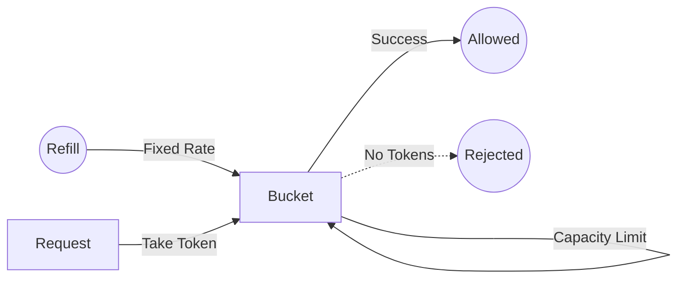
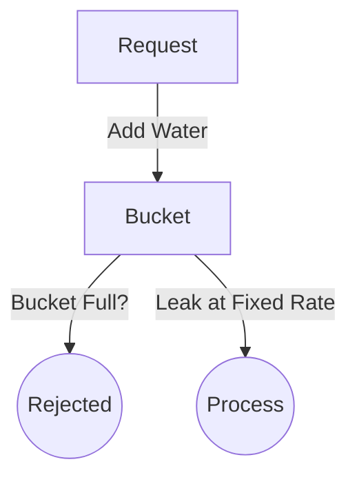
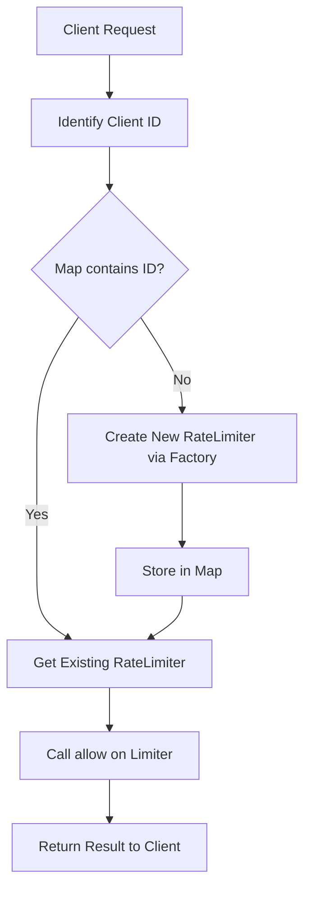

# Java Rate Limiting Implementations

This project provides production-ready implementations of various rate limiting algorithms in Java. It is designed to be easy to understand, following standard coding principles and design patterns.

## Implemented Algorithms

### 1. Token Bucket
- **How it works:** Imagine a bucket that holds tokens. Tokens are added to the bucket at a fixed rate. Each request must consume a token. If the bucket is empty, the request is rejected.
- **Lock-Free Variant:** `LockFreeTokenBucketRateLimiter` uses `AtomicReference` to handle refill and consumption without blocking.
- **Visual Logic:**

- **Pros:** Allows for bursts of traffic.
- **Use Case:** Most common algorithm used in modern APIs (e.g., AWS, Stripe).

### 2. Leaky Bucket
- **How it works:** Requests enter a "leaky bucket" and leak out at a constant rate. If the bucket (the queue) is full, new requests are discarded.
- **Lock-Free Variant:** `LockFreeLeakyBucketRateLimiter` ensures atomic leak and add operations using CAS loops.
- **Visual Logic:**

- **Pros:** Smooths out traffic spikes to a constant rate.
- **Use Case:** Network traffic shaping.

### 3. Fixed Window Counter
- **How it works:** Divides time into fixed windows (e.g., 1 minute). Each window has a counter. If the counter exceeds the limit, requests are rejected until the next window starts.
- **Lock-Free Variant:** `LockFreeFixedWindowRateLimiter` avoids lock contention during window resets.
- **Visual Logic:**
```mermaid
flowchart TD
    Request[Request] -->|Current Window| Counter{Counter < Limit?}
    Counter -- Yes -->|Increment| Allowed((Allowed))
    Counter -- No --> Rejected((Rejected))
    Timer[Window Timer] -->|Reset Counter| Counter
```
- **Pros:** Simple and memory-efficient.
- **Cons:** Can allow twice the limit at the edges of windows.

### 4. Lock-Free Fixed Window Counter
- **How it works:** Similar to Fixed Window but uses an `AtomicReference` with an immutable state object to avoid locks (`synchronized` blocks). This ensures high performance under extreme concurrency while maintaining correctness during window transitions.
- **Pros:** High throughput, non-blocking.
- **Use Case:** High-concurrency systems where lock contention is a bottleneck.

### 5. Sliding Window Log
- **How it works:** Keeps a log of timestamps for all requests within the window. Before each request, it removes timestamps outside the window and counts the remainder.
- **Lock-Free Variant:** `LockFreeSlidingWindowLogRateLimiter` uses an immutable list of timestamps for atomic updates (higher memory overhead).
- **Visual Logic:**
```mermaid
flowchart TD
    Request[Request] -->|Remove Old Logs| Logs[Log Queue]
    Logs -->|Count Logs| Check{Count < Limit?}
    Check -- Yes -->|Add Timestamp| Allowed((Allowed))
    Check -- No --> Rejected((Rejected))
```
- **Pros:** Very accurate.
- **Cons:** High memory usage as it stores every request's timestamp.

### 6. Sliding Window Counter (Hybrid)
- **How it works:** A combination of Fixed Window and Sliding Window Log. It uses a weighted average of the current and previous window to estimate the current rate.
- **Lock-Free Variant:** `LockFreeSlidingWindowCounterRateLimiter` manages multiple window counters and timestamps atomically.
- **Visual Logic:**
```mermaid
flowchart TD
    Request[Request] -->|Calculate Weight| WeightedSum[Current + Prev * Weight]
    WeightedSum -->|Check Limit| Check{Sum < Limit?}
    Check -- Yes -->|Increment Current| Allowed((Allowed))
    Check -- No --> Rejected((Rejected))
```
- **Pros:** Memory-efficient like Fixed Window, but smoother like Sliding Window Log.

## Usage Patterns

### 1. Global Rate Limiting
If you want to limit the total traffic to your application, you can use a single instance of a `RateLimiter` shared across all requests.
```java
RateLimiter globalLimiter = RateLimiterFactory.createRateLimiter(Algorithm.FIXED_WINDOW, 100, 60000); // 100 RPM total
```

### 2. Client-Specific Rate Limiting
To limit traffic on a per-client basis (e.g., by IP address or API Key), use the `RateLimitManager`.
- **Workflow Visualization:**

```java
RateLimitManager manager = new RateLimitManager(Algorithm.TOKEN_BUCKET, 10, 1); // 10 tokens per client
boolean allowed = manager.allow("client-ip-123");
```

## Design Patterns Used
- **Strategy Pattern:** The `RateLimiter` interface defines the strategy, and each algorithm is a concrete implementation.
- **Factory Pattern:** `RateLimiterFactory` encapsulates the creation logic.
- **Provider/Manager Pattern:** `RateLimitManager` handles the mapping of clients to their respective limiters.

## Getting Started

### Prerequisites
- Java 21+
- Maven

### Running the Demo
```bash
mvn compile exec:java -Dexec.mainClass="org.example.Main"
```

### Running Tests
```bash
mvn test
```
The test suite is designed to facilitate a deep understanding of the implementations:
- `RateLimiterTest`: Demonstrates the core logic, time-based refill/leak behavior, and window transitions for all algorithms.
- `RateLimiterConcurrencyTest`: Shows how the implementations behave under high-load multi-threaded scenarios, ensuring thread-safety (critical for production).
- `RateLimiterEdgeCaseTest`: Covers boundary conditions like zero limits, bursts exceeding capacity, and invalid inputs.

## Project Structure

- `org.example.ratelimiter`: Core interface and Factory.
- `org.example.ratelimiter.algorithms`: Implementation of different rate limiting algorithms.
- `org.example.ratelimiter.exception`: Custom exceptions for rate limiting.
- `src/test/java/org.example.ratelimiter`: Unit tests for verifying the algorithms.

## Production Considerations
In a real-world production environment, you should consider:
1. **Distributed Rate Limiting:** Using a shared data store like Redis to synchronize limits across multiple application instances.
2. **Client Identification:** Identifying clients via API keys, IP addresses, or User IDs.
3. **HTTP Headers:** Returning `X-RateLimit-Limit`, `X-RateLimit-Remaining`, and `Retry-After` headers.
4. **Metrics and Monitoring:** Integrating with tools like Prometheus/Grafana to track rate limiting events.
5. **Precision:** For high-precision requirements, consider using `System.nanoTime()` instead of `System.currentTimeMillis()`.
